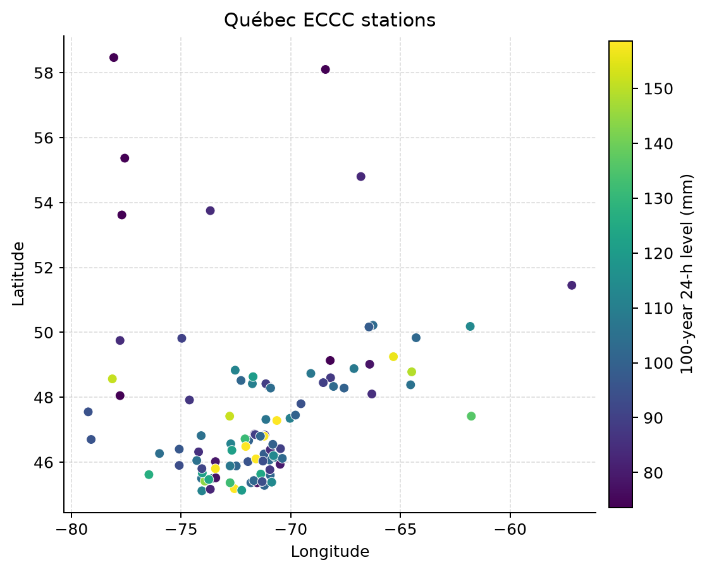

# How-to

Short answers to common questions. The numbers below were produced by
running the snippets; they are not typed in.

## How do I plot diagnostics and IDF curves?

Install the optional extra, then call `plot_diagnostics()` on a GEV, GPD or
POT fit, or `plot()` on an IDF fit. Both need matplotlib:
`pip install "rare-tails[plots]"`.

```python
import tails
from tails.datasets import load_eccc_quebec

df = load_eccc_quebec()
y = df.loc[df.station_id == "701S001", "24h"].to_numpy()  # 24-h annual max, mm
fit = tails.fit_gev(y)
fig, axes = fit.plot_diagnostics(ci="profile")
```

That draws a 2×2 figure: QQ and PP plots with a simulated 95% envelope, a
return-level curve with a profile-likelihood ribbon, and a histogram plus the
fitted density. For a batched fit, `index` selects the series (default 0).
`ReturnLevels.plot()` draws just the return-level panel.


IDF curves use the same style — one line and a confidence ribbon per return
period, on log–log axes in mm/h against duration in hours. The points are the
empirical T-year intensities at each duration (Weibull plotting positions),
not a cloud of raw annual maxima.

```python
from tails.idf import IDFData, fit_idf

data = IDFData.from_eccc("701S001")
idf = fit_idf(data, "general", "matern")
ax = idf.plot(periods=(2, 10, 25, 100), ci="hessian")
```

At Québec City the 100-year 1-hour intensity on this fit is 43.6 mm/h. The
empirical 100-year point at 1 h is 59.9 mm/h — the 1979 storm, which sits
above the pooled curve. `ci` can be `"hessian"`, `"sandwich"`, `"bootstrap"`,
or `None` for the curves alone.

## How do I map a batch of return levels?

`tails.plot_return_level_map` draws one return level at each location.
Longitude and latitude come from the data, in degrees. Stations are a
scatter; a latitude × longitude grid is a mesh. The colour is the level in
the units of the fit. Pass `label` to name those units.
`ReturnLevels.plot_map(lon, lat, period=100)` is the same plot. This needs
the `plots` extra, as above.

The batch below is the quickstart's 151 Québec stations, 24-hour annual
maxima in millimetres. A station with fewer than 20 years, or with a shape
estimate outside (−0.5, 0.5), is set to NaN and left off the map. That
removes Cap Tourmente (`7041177`, 11 years, ξ ≈ 1.24) and 52 other series.
The 98 that remain run from 63.0 mm at Inukjuak to 247.9 mm at Charlevoix
(MRC). The median is 101.8 mm. Québec City (Jean Lesage, `701S001`) is
102.1 mm, the same 100-year level as the single-station fit. The colour
scale is the 5th to 95th percentile of those 98 levels, 73.6–158.6 mm, so
the Charlevoix value does not flatten the rest.

```python
import numpy as np
import tails
from tails.datasets import load_eccc_quebec

df = load_eccc_quebec()
wide = df.pivot_table(index="station_id", columns="year", values="24h")
meta = df.drop_duplicates("station_id").set_index("station_id").loc[wide.index]
fit = tails.fit_gev(wide.to_numpy())
level = np.asarray(fit.return_level([100]).estimate)[:, 0].copy()
keep = (fit.nobs >= 20) & (np.abs(fit.params["shape"]) < 0.5)
level[~keep] = np.nan
shown = level[np.isfinite(level)]
vmin, vmax = np.quantile(shown, [0.05, 0.95])
ax = tails.plot_return_level_map(
    level,
    meta.lon.to_numpy(),
    meta.lat.to_numpy(),
    period=100,
    vmin=vmin,
    vmax=vmax,
    label="100-year 24-h level (mm)",
    title="Québec ECCC stations",
)
```



An xarray result uses the coordinates it already carries (`lat`/`lon` or
`latitude`/`longitude`). Pass `period` when the array holds more than one
return period. A Dataset from xclim's `frequency_analysis(..., ci=...)` is
the same call: the function reads its `return_level` variable.

```python
import tails.xarray as tx

ds = tx.fit_gev(annual_max, dim="year")   # lat, lon, and the year of the maxima
tails.plot_return_level_map(tx.return_level(ds, [20, 100]), period=100)
```

## How do I start from a datetime series?

`fit_block_maxima` takes one series with timestamps, keeps the maximum of each
block, and fits it. `fit_peaks` keeps peaks over a threshold, with optional
runs declustering. Either result has `summary()`, a table of return levels,
and `parameters()`, the fitted location, scale and shape. The shape is ξ.

`model="aic"` fits the full model and the nested model with ξ fixed at 0
(Gumbel for block maxima, exponential for peaks) and keeps the smaller AIC.
A tie keeps the simpler model. `model="gev"` or `"gpd"` skips that comparison.

The series below is the Québec City 24-hour record from the quickstart, with
one timestamp per annual maximum. A daily series is the same call:
`freq="YS"` takes one maximum per year. Set `min_count` when a short block
should not count (300 is a typical rule for daily data).

```python
import pandas as pd
import tails
from tails.datasets import load_eccc_quebec

df = load_eccc_quebec()
sub = df.loc[df.station_id == "701S001", ["year", "24h"]].dropna()
series = pd.Series(
    sub["24h"].to_numpy(),
    index=pd.to_datetime(sub["year"].astype(str), format="%Y"),
    name="701S001",
)
ext = tails.fit_block_maxima(series, model="aic")
print(ext)
print(ext.summary(periods=[20, 100]).to_string(index=False))
```

```
SeriesExtremes(kind='blocks', model='gumbel', n=64, loc=51.5, scale=11.56, ξ=0 fixed, AIC gev=519.82, gumbel=517.93)

 period   estimate     lower      upper
   20.0  85.829137 78.908678  94.825236
  100.0 104.669085 94.880203 117.595400
```

On these 64 years the free GEV shape is about −0.026, and AIC prefers the
Gumbel model (517.9 against 519.8). The 100-year level is 104.7 mm, with a
95% profile interval of 94.9–117.6 mm. That interval is narrower than the
three-parameter profile interval in the quickstart (90.5–131.1 mm around
102.1 mm) because ξ is held at 0, not because the record got longer. Pass
`model="gev"` to keep the three-parameter fit; the table then matches the
quickstart. A standard error of 0 on ξ means the shape was fixed.

`ext.extremes` is the block-maxima series. `ext.fit` is the `GEVFit`, so
`plot_diagnostics()` and `return_level()` are unchanged.

Peaks use the same object. `npy`, the number of observations per year, is
inferred from the spacing of the index when you do not pass it (about 365.25
for daily data, about 1 if the series is already annual). `run_length` is a
number of observations, as in `decluster_runs`, or an offset such as `"24h"`.
`daily` here is a pandas Series with a DatetimeIndex.

```python
peaks = tails.fit_peaks(daily, threshold=20.0, run_length="24h", model="aic")
peaks.summary()              # delta-method intervals
peaks.summary(ci="profile")  # joint profile of excesses and the exceedance rate
```

`summary()` on a peaks result defaults to the delta method. `ci="profile"` and
`ci="bootstrap"` match `POTFit.return_level`. An exponential model keeps ξ = 0
inside the profile interval.

## How rare was this storm?

`tails.how_rare(series, value_or_date)` fits a GEV (or a POT model) and
returns the return period, a confidence interval, and a plain-language
sentence. If `series` has a DatetimeIndex, you can pass a date instead of a
number. Pass `plot=True` to mark the event on a return-level chart.

```python
import pandas as pd
import tails
from tails.idf import IDFData

data = IDFData.from_eccc("701S001")
# 24-h column is stored as intensity (mm/h); convert back to depth (mm).
depth = pd.Series(
    data.values[:, -1] * 24.0,
    index=pd.to_datetime(data.years.astype(str), format="%Y"),
)
result = tails.how_rare(depth, "2005-01-01", ci="profile", unit="mm", name="Québec City")
print(result.sentence)
print(result.return_period, result.lower, result.upper)
```

```
A value of 105.4 mm in 2005 at Québec City is a 1-in-138-year event (95% CI: 30–1212 years).
138.276...  29.63...  1212.48...
```

The 2005 24-hour total of 105.4 mm is a little above the 100-year level
(102.1 mm, 95% profile interval 90.5–131.1 mm), so the return-period interval
is wide — a 64-year record cannot pin down a 138-year event tightly, and the
sentence says so. `ci="delta"` or `"bootstrap"` are also accepted. For
peaks-over-threshold, pass `model="pot"` and a `threshold`; the same three
intervals are available, and `"profile"` is the default there too.


## Are these records happening more often than chance?

`record_breaks` does not fit a GEV. Under an unchanging climate the chance that year `t` sets a record is `1/t`, so a 64-year series expects about 4.7 records of either kind. `foster_stuart` then asks two separate questions: are the records mostly highs rather than lows (a drift), and are there too many records of both kinds (the spread is changing)?

```python
import pandas as pd
from tails.datasets import load_eccc_quebec
from tails.records import foster_stuart, record_breaks

df = load_eccc_quebec()
sub = df.loc[df.station_id == "701S001", ["year", "24h"]].dropna()
series = pd.Series(
    sub["24h"].to_numpy(),
    index=pd.to_datetime(sub["year"].astype(str), format="%Y"),
)
breaks = record_breaks(series)
print(breaks.summary().to_string(index=False))
print(breaks.events().to_string(index=False))
print(foster_stuart(series).summary().to_string(index=False))
```

Québec City, 24-hour annual maxima, 1961–2024: 7 upper records against 4.74 expected (ratio 1.48, one-sided p = 0.16). The record years are 1961 (61.7 mm), 1962 (71.4), 1978 (78.9), 1979 (81.2), 1996 (83.0), 1998 (104.8) and 2005 (105.4). Foster–Stuart D is 2 (one-sided p = 0.29 for an upward drift) and S is 10 against 7.49 expected. Neither departure is large for a 64-year series. `kind="lower"` counts record minima. A batch is an array whose last axis is time; `summary()` then has one row per series.

## How do I download ECCC station data?

`tails.datasets.eccc_daily` and `eccc_hourly` talk to the official MSC GeoMet
OGC API at [api.weather.gc.ca](https://api.weather.gc.ca). Pass a climate
identifier or a station name, and a year or an inclusive `(start, end)`
range. Downloads are cached under `$TAILS_CACHE` or `~/.cache/tails`.

```python
from tails.datasets import eccc_daily, eccc_stations

eccc_stations("701S001")
#   station_id                 station_name   lat        lon
#      701S001   QUEBEC/JEAN LESAGE INTL   46.80   -71.38

df = eccc_daily("701S001", 2020)
df[["tmax", "tmin", "tmean", "precip"]].head()
```

```
            tmax  tmin  tmean  precip
time
2020-01-01  -0.7  -4.9   -2.8     1.5
2020-01-02  -0.2  -2.4   -1.3     0.7
2020-01-03   2.4  -1.3    0.5     0.2
2020-01-04   1.4  -3.1   -0.8     1.0
2020-01-05  -3.1 -14.3   -8.7     0.8
```

2020 has 366 daily rows at this station and 1,296.7 mm of total
precipitation. `df.attrs` holds the station id, name, coordinates, and a
link to the API. `eccc_hourly("701S001", (2019, 2020))` is the same idea for
hourly observations (`temp`, `precip`, wind, pressure). If a name matches
several sites, the call raises with the candidate climate identifiers so you
can pick one.

## Why is my first fit slow, and how do I make it fast?

The first time you call a model, JAX compiles its likelihood and Hessian for
your CPU or GPU. That takes a few seconds. Every later call in the same
session reuses the compiled code, which is why fitting thousands of series
afterwards feels instant.

tails also saves those compiled kernels to disk, so the *next* Python session
does not compile them again. For example, a first `fit_gev` plus a profile
interval drops from about 5 s in a fresh environment to under 2 s once the
cache is warm. You do not need to do anything; it is on by default.

```python
import tails._jax

tails._jax.compilation_cache_dir()   # where the kernels live, or None if off
```

The cache sits in `$TAILS_CACHE/jax` (default `~/.cache/tails/jax`) and is
small (well under a megabyte for the common models). Set `TAILS_JAX_CACHE=0`
to turn it off, for example on a read-only file system. If you already set
`JAX_COMPILATION_CACHE_DIR` for your own JAX code, tails uses yours.
