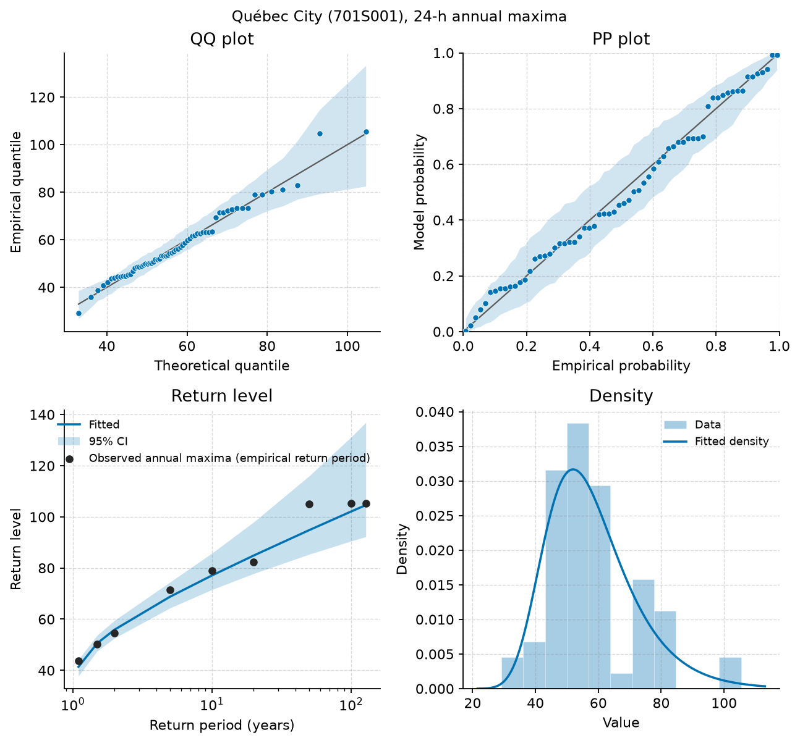
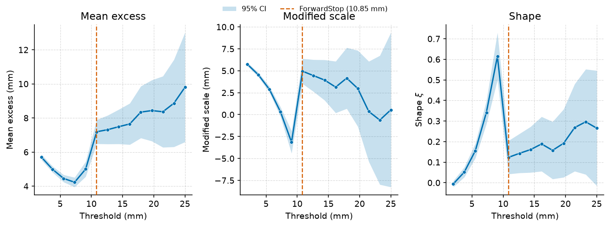
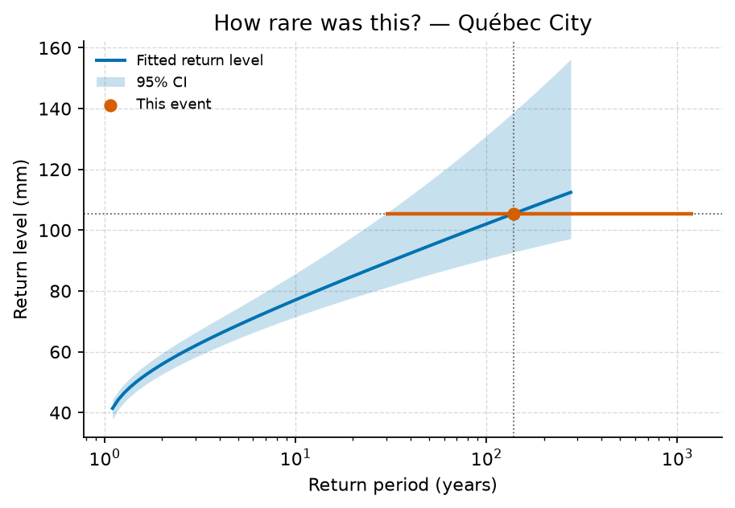

# How-to

Short answers to common questions. The numbers below were produced by
running the snippets; they are not typed in.

## How do I plot diagnostics and IDF curves?

Install the optional extra, then call `plot_diagnostics()` on a GEV, GPD or
POT fit, or `plot()` on an IDF fit. Both need matplotlib:
`pip install "rare-tails[plots]"`.

```python
import tails
from tails.datasets import load_eccc_quebec

df = load_eccc_quebec()
y = df.loc[df.station_id == "701S001", "24h"].to_numpy()  # 24-h annual max, mm
fit = tails.fit_gev(y)
fig, axes = fit.plot_diagnostics(ci="profile")
```

That draws a 2×2 figure: QQ and PP plots with a simulated 95% envelope, a
return-level curve with a profile-likelihood ribbon, and a histogram plus the
fitted density. For a batched fit, `index` selects the series (default 0).
`ReturnLevels.plot()` draws just the return-level panel.



A non-stationary GEV uses the same method. The figure is one panel: the
block maxima, the fitted return level along the covariate, and a confidence
ribbon. `period` defaults to 2, the median of the fitted GEV. `ci` is
`"delta"`, `"profile"` or `"bootstrap"`.

The horizontal axis is the covariate passed to `fit_gev`. That can be a
year, a temperature index, or any other series, on the location, the scale,
or the shape. An array with no name is labelled "Covariate". A pandas
column name is copied onto the axis. With more than one distinct covariate
column, the points stay in observation order and the line is the return
level at each row.

```python
import pandas as pd

covariate = pd.Series(range(1961, 1961 + len(y)), name="year", dtype="float64")
trend = tails.fit_gev(y, loc=covariate)
fig, ax = trend.plot_diagnostics(ci="delta")  # or ci="profile"
```

`y` is the series from the stationary example above. The axes are the
covariate and the block maximum. The same call with a column named
`"temperature"` labels the axis "temperature".

IDF curves use the same style — one line and a confidence ribbon per return
period, on log–log axes in mm/h against duration in hours. The points are the
empirical T-year intensities at each duration (Weibull plotting positions),
not a cloud of raw annual maxima.

```python
from tails.idf import IDFData, fit_idf

data = IDFData.from_eccc("701S001")
idf = fit_idf(data, "general", "matern")
ax = idf.plot(periods=(2, 10, 25, 100), ci="hessian")
```

At Québec City the 100-year 1-hour intensity on this fit is 43.6 mm/h. The
empirical 100-year point at 1 h is 59.9 mm/h — the 1979 storm, which sits
above the pooled curve. `ci` can be `"hessian"`, `"sandwich"`, `"bootstrap"`,
or `None` for the curves alone.

## How do I map a batch of return levels?

`tails.plot_return_level_map` draws one return level at each location.
Longitude and latitude come from the data, in degrees. Stations are a
scatter; a latitude × longitude grid is a mesh. The colour is the level in
the units of the fit. Pass `label` to name those units.
`ReturnLevels.plot_map(lon, lat, period=100)` is the same plot. This needs
the `plots` extra, as above.

The batch below is the quickstart's 151 Québec stations, 24-hour annual
maxima in millimetres. A station with fewer than 20 years, or with a shape
estimate outside (−0.5, 0.5), is set to NaN and left off the map. That
removes Cap Tourmente (`7041177`, 11 years, ξ ≈ 1.24) and 52 other series.
The 98 that remain run from 63.0 mm at Inukjuak to 247.9 mm at Charlevoix
(MRC). The median is 101.8 mm. Québec City (Jean Lesage, `701S001`) is
102.1 mm, the same 100-year level as the single-station fit. The colour
scale is the 5th to 95th percentile of those 98 levels, 73.6–158.6 mm, so
the Charlevoix value does not flatten the rest.

```python
import numpy as np
import tails
from tails.datasets import load_eccc_quebec

df = load_eccc_quebec()
wide = df.pivot_table(index="station_id", columns="year", values="24h")
meta = df.drop_duplicates("station_id").set_index("station_id").loc[wide.index]
fit = tails.fit_gev(wide.to_numpy())
level = np.asarray(fit.return_level([100]).estimate)[:, 0].copy()
keep = (fit.nobs >= 20) & (np.abs(fit.params["shape"]) < 0.5)
level[~keep] = np.nan
shown = level[np.isfinite(level)]
vmin, vmax = np.quantile(shown, [0.05, 0.95])
ax = tails.plot_return_level_map(
    level,
    meta.lon.to_numpy(),
    meta.lat.to_numpy(),
    period=100,
    vmin=vmin,
    vmax=vmax,
    label="100-year 24-h level (mm)",
    title="Québec ECCC stations",
)
```


An xarray result uses the coordinates it already carries (`lat`/`lon` or
`latitude`/`longitude`). Pass `period` when the array holds more than one
return period. A Dataset from xclim's `frequency_analysis(..., ci=...)` is
the same call: the function reads its `return_level` variable.

```python
import tails.xarray as tx

ds = tx.fit_gev(annual_max, dim="year")   # lat, lon, and the year of the maxima
tails.plot_return_level_map(tx.return_level(ds, [20, 100]), period=100)
```

## How do I choose a threshold?

`plot_threshold` draws the usual checks for one series: the mean excess
(mean residual life) with a confidence ribbon, the GPD modified scale
σ − ξu and the shape ξ across candidate thresholds, and the ForwardStop
choice as a dashed line. `unit` is the axis label. The plots extra is
required, the same as `plot_diagnostics`:
`pip install "rare-tails[plots]"`.

```python
import numpy as np
from scipy import stats

import tails

rng = np.random.default_rng(0)
body = rng.uniform(0.0, 10.0, size=5000)
excess = stats.genpareto.rvs(0.15, scale=6.0, size=700, random_state=rng)
rain = np.concatenate([body, 10.0 + excess])  # synthetic daily rainfall, mm
thresholds = np.linspace(2.0, 25.0, 14)
fig, axes = tails.plot_threshold(rain, thresholds, unit="mm")
```

Above a valid threshold the mean excess is linear and the modified scale and
shape level off. ForwardStop (Bader, Yan & Zhang, 2018) keeps the lowest
candidate that is not rejected. On this series that is 10.85 mm. The tail was
drawn from a generalised Pareto distribution above 10 mm with shape 0.15; the
fitted shape at 10.85 mm is 0.12, and the ribbon widens as the number of
exceedances falls. Pass the chosen value to `fit_pot`.



Leave `thresholds` out for a default quantile grid. `alpha`, `n_boot` and
`seed` are the same arguments as `mean_residual_life`, `parameter_stability`
and `select_threshold`.

## How do I start from a datetime series?

`fit_block_maxima` takes one series with timestamps, keeps the maximum of each
block, and fits it. `fit_peaks` keeps peaks over a threshold, with optional
runs declustering. Either result has `summary()`, a table of return levels,
and `parameters()`, the fitted location, scale and shape. The shape is ξ.

`model="aic"` fits the full model and the nested model with ξ fixed at 0
(Gumbel for block maxima, exponential for peaks) and keeps the smaller AIC.
A tie keeps the simpler model. `model="gev"` or `"gpd"` skips that comparison.

The series below is the Québec City 24-hour record from the quickstart, with
one timestamp per annual maximum. A daily series is the same call:
`freq="YS"` takes one maximum per year. Set `min_count` when a short block
should not count (300 is a typical rule for daily data).

```python
import pandas as pd
import tails
from tails.datasets import load_eccc_quebec

df = load_eccc_quebec()
sub = df.loc[df.station_id == "701S001", ["year", "24h"]].dropna()
series = pd.Series(
    sub["24h"].to_numpy(),
    index=pd.to_datetime(sub["year"].astype(str), format="%Y"),
    name="701S001",
)
ext = tails.fit_block_maxima(series, model="aic")
print(ext)
print(ext.summary(periods=[20, 100]).to_string(index=False))
```

```
SeriesExtremes(kind='blocks', model='gumbel', n=64, loc=51.5, scale=11.56, ξ=0 fixed, AIC gev=519.82, gumbel=517.93)

 period   estimate     lower      upper
   20.0  85.829137 78.908678  94.825236
  100.0 104.669085 94.880203 117.595400
```

On these 64 years the free GEV shape is about −0.026, and AIC prefers the
Gumbel model (517.9 against 519.8). The 100-year level is 104.7 mm, with a
95% profile interval of 94.9–117.6 mm. That interval is narrower than the
three-parameter profile interval in the quickstart (90.5–131.1 mm around
102.1 mm) because ξ is held at 0, not because the record got longer. Pass
`model="gev"` to keep the three-parameter fit; the table then matches the
quickstart. A standard error of 0 on ξ means the shape was fixed.

`ext.extremes` is the block-maxima series. `ext.fit` is the `GEVFit`, so
`plot_diagnostics()` and `return_level()` are unchanged.

Peaks use the same object. `npy`, the number of observations per year, is
inferred from the spacing of the index when you do not pass it (about 365.25
for daily data, about 1 if the series is already annual). `run_length` is a
number of observations, as in `decluster_runs`, or an offset such as `"24h"`.
`daily` here is a pandas Series with a DatetimeIndex.

```python
peaks = tails.fit_peaks(daily, threshold=20.0, run_length="24h", model="aic")
peaks.summary()              # delta-method intervals
peaks.summary(ci="profile")  # joint profile of excesses and the exceedance rate
```

`summary()` on a peaks result defaults to the delta method. `ci="profile"` and
`ci="bootstrap"` match `POTFit.return_level`. An exponential model keeps ξ = 0
inside the profile interval.

## How rare was this?

`tails.how_rare(series, value_or_date)` fits a GEV (or a POT model) and
returns the return period, a confidence interval, and a plain-language
sentence. If `series` has a DatetimeIndex, you can pass a date instead of a
number. Pass `plot=True` to mark the event on a return-level chart. `unit`
is the label in that sentence, so the same call covers a rainfall depth, a
yield move, a fuel price, an insurance claims week, or an earthquake
magnitude.

### A rainfall storm

Bundled Québec City 24-hour annual maxima (station `701S001`). The 24-hour
column is stored as intensity (mm/h); the snippet converts it back to depth
(mm).

```python
import pandas as pd
import tails
from tails.idf import IDFData

data = IDFData.from_eccc("701S001")
# 24-h column is stored as intensity (mm/h); convert back to depth (mm).
depth = pd.Series(
    data.values[:, -1] * 24.0,
    index=pd.to_datetime(data.years.astype(str), format="%Y"),
)
result = tails.how_rare(depth, "2005-01-01", ci="profile", unit="mm", name="Québec City")
print(result.sentence)
print(result.return_period, result.lower, result.upper)
```

```
A value of 105.4 mm in 2005 at Québec City is a 1-in-138-year event (95% CI: 30–1212 years).
138.276...  29.63...  1212.48...
```

The 2005 24-hour total of 105.4 mm is a little above the 100-year level
(102.1 mm, 95% profile interval 90.5–131.1 mm), so the return-period interval
is wide — a 64-year record cannot pin down a 138-year event tightly, and the
sentence says so.



The four series below are published annual maxima, copied here so the
snippet runs without a download. Each one is a case where a return period
is the decision: a rates stress, a fuel hedge, an insurance trust fund, a
seismic catalog. `ci="delta"` or `"bootstrap"` are also accepted. For
peaks-over-threshold, pass `model="pot"` and a `threshold`; the same three
intervals are available, and `"profile"` is the default there too.

### A Treasury yield move

A desk that holds Treasury bonds needs a one-day stress in yield, in basis
points, because that move is the loss on the book. The series is the largest
rise each year in the US 10-year par yield, from one published fixing to the
next, 1990–2025. Source: U.S. Department of the Treasury, Daily Treasury Par
Yield Curve Rates (public domain),
[10-year column](https://home.treasury.gov/resource-center/data-chart-center/interest-rates/TextView?type=daily_treasury_yield_curve).

The largest step in the record is 39 basis points, from 6.77% on 31 March
1994 to 7.16% on 4 April 1994. There is no fixing for 1 April 1994, so that
step spans the holiday weekend.

```python
import pandas as pd
import tails

years = range(1990, 2026)
# Annual maximum rise in the 10-year par yield, basis points.
rise_bp = [
    28, 11, 17, 15, 39, 18, 34, 18, 22, 21, 16, 25, 24, 24, 24, 14, 12, 16,
    24, 24, 20, 19, 15, 21, 10, 15, 19, 10, 10, 11, 29, 16, 28, 15, 19, 14,
]
yields = pd.Series(rise_bp, index=pd.to_datetime([f"{y}-01-01" for y in years]))
result = tails.how_rare(yields, "1994-01-01", ci="profile", unit="basis points")
print(result.sentence)
print(result.return_period, result.lower, result.upper)
```

```
A value of 39 basis points in 1994 is a 1-in-74-year event (95% CI: 13–758 years).
73.672...  12.891...  757.70...
```

Thirty-six annual maxima leave that 74-year stress between 13 and 758 years.
The interval is the part a limit or a capital rule has to live with.

### A fuel price

A utility or a gas buyer hedges a spot price, in dollars per million Btu.
The series is the highest daily Henry Hub spot price in each year,
1997–2025. Source: U.S. Energy Information Administration, series RNGWHHD,
Henry Hub Natural Gas Spot Price (public domain),
[daily history](https://www.eia.gov/dnav/ng/hist/rngwhhdd.htm).

The high is 23.86 USD per million Btu on 17 February 2021.

```python
import pandas as pd
import tails

years = range(1997, 2026)
# Annual maximum of the daily Henry Hub spot price, USD per million Btu.
price = [
    4.71, 2.61, 3.10, 10.48, 10.31, 5.31, 18.48, 8.12, 14.84, 9.90,
    8.16, 13.31, 6.10, 7.51, 4.92, 3.77, 4.52, 8.15, 3.32, 3.80,
    3.71, 6.24, 4.25, 3.14, 23.86, 9.85, 3.78, 13.20, 9.86,
]
gas = pd.Series(price, index=pd.to_datetime([f"{y}-01-01" for y in years]))
result = tails.how_rare(gas, "2021-01-01", ci="profile", unit="USD per million Btu")
print(result.sentence)
print(result.return_period, result.lower, result.upper)
```

```
A value of 23.86 USD per million Btu in 2021 is a 1-in-24-year event (95% CI: 7.1–70 years).
23.640...  7.081...  70.354...
```

On this fit the 2021 price is a 1-in-24-year event, with a 95% profile
interval of 7.1–70 years. The fitted shape is about 0.50, so the tail is
heavy: the worst price in a 29-year sample is not, by itself, a 100-year
price. That is the difference a hedge has to be written against.

### An unemployment-insurance week

State unemployment-insurance funds pay the weekly initial-claims load. The
series is the highest seasonally adjusted weekly initial claims in each
year, 1967–2025, in millions of claims. Source: U.S. Employment and Training
Administration, Initial Claims [ICSA], retrieved from FRED, Federal Reserve
Bank of St. Louis (the ETA series is a federal statistic),
[ICSA](https://fred.stlouisfed.org/series/ICSA).

The week ending 4 April 2020 was 6.137 million claims. The next highest week
in the record is 0.890 million, in 2021, and the 1982 and 2009 peaks are
0.695 and 0.665 million.

```python
import pandas as pd
import tails

years = range(1967, 2026)
# Annual maximum of weekly initial claims, millions, seasonally adjusted.
claims = [
    0.310, 0.251, 0.232, 0.374, 0.359, 0.350, 0.326, 0.537, 0.575, 0.423,
    0.565, 0.429, 0.471, 0.642, 0.558, 0.695, 0.534, 0.439, 0.426, 0.416,
    0.370, 0.361, 0.407, 0.474, 0.509, 0.564, 0.415, 0.406, 0.390, 0.426,
    0.347, 0.376, 0.345, 0.364, 0.517, 0.479, 0.450, 0.380, 0.424, 0.349,
    0.360, 0.587, 0.665, 0.507, 0.468, 0.446, 0.375, 0.345, 0.317, 0.290,
    0.297, 0.252, 0.247, 6.137, 0.890, 0.250, 0.259, 0.258, 0.259,
]
ui = pd.Series(claims, index=pd.to_datetime([f"{y}-01-01" for y in years]))
result = tails.how_rare(ui, "2020-01-01", ci="profile", unit="million claims")
print(result.sentence)
print(result.return_period, result.lower, result.upper)
```

```
A value of 6.137 million claims in 2020 is a 1-in-6654-year event (95% CI: 4251–50099 years).
6653.507...  4250.79...  50099.41...
```

A fund sized from the 1982 or 2009 peak was sized for a week near 0.7
million claims. The stationary fit puts the April 2020 week at 6654 years,
and the profile interval stays in the thousands (4251–50099). Fifty-nine
years that contain one week of that size do not produce a tight period.
That width is what the trust-fund question actually gets from this record.

### An earthquake magnitude

A seismic catalog answers how often the largest earthquake of the year
reaches a given magnitude. The series is that annual maximum, moment
magnitude (Mw), for 1950–2025. Source: U.S. Geological Survey earthquake
catalog (public domain), events of magnitude at least 7. Every year in this
window has its maximum inside that extract. The 22 May 1960 Valdivia
earthquake is Mw 9.5.

```python
import pandas as pd
import tails

years = range(1950, 2026)
# Annual maximum moment magnitude, USGS catalog.
magnitude = [
    8.60, 7.81, 9.00, 7.90, 7.80, 7.52, 7.70, 8.60, 8.30, 7.90,
    9.50, 7.60, 7.47, 8.50, 9.20, 8.70, 8.10, 7.30, 8.20, 8.20,
    8.00, 8.10, 8.00, 7.70, 7.60, 7.90, 8.00, 8.30, 7.70, 7.90,
    7.90, 7.70, 7.29, 7.60, 7.60, 8.00, 8.00, 7.90, 7.80, 8.02,
    7.80, 7.60, 7.80, 7.80, 8.30, 8.00, 8.09, 7.80, 8.10, 7.70,
    8.00, 8.40, 7.90, 8.16, 9.10, 8.60, 8.30, 8.40, 7.90, 8.10,
    8.80, 9.10, 8.60, 8.30, 8.20, 8.30, 7.90, 8.20, 8.20, 8.00,
    7.80, 8.20, 7.60, 7.80, 7.50, 8.80,
]
quakes = pd.Series(magnitude, index=pd.to_datetime([f"{y}-01-01" for y in years]))
result = tails.how_rare(quakes, "1960-01-01", ci="profile", unit="Mw")
print(result.sentence)
print(result.return_period, result.lower, result.upper)
```

```
A value of 9.5 Mw in 1960 is a 1-in-123-year event (95% CI: 29–1004 years).
123.447...  29.327...  1003.95...
```

Mw 9.5 in 1960 is a 1-in-123-year annual maximum on this fit. The 95%
profile interval is 29–1004 years. Seventy-six years of the global maximum
do not pin the period of a magnitude 9.5 earthquake any tighter than that.
This is the catalog question (how often the year's largest event is this
large). A design ground motion at a site is a further step.

## How do I use more than the annual maximum?

Annual maxima keep one value per year. The second- and third-largest rain days
of a year come from the same tail, and the r-largest model uses them: it fits
the same GEV (`loc`, `scale`, `shape` of the annual maximum) to the `r`
largest values of each block. `tails.block_top_r` picks those values from a
datetime series, keeping events apart so one storm counts once, and
`tails.fit_gev(top, r=r)` fits them. `r=1` is the ordinary block-maxima fit.

```python
import tails
from tails.datasets import eccc_daily

# Montréal-Trudeau daily rainfall, 1942–2012 (ECCC climate ID 7025250).
rain = eccc_daily("7025250", (1942, 2012))["precip"]

# The five largest separate rain days of each year (at least 3 days apart).
top = tails.block_top_r(rain, 5, min_separation="3D", min_count=330)

for r in (1, 3, 5):
    fit = tails.fit_gev(top.to_numpy(), r=r)
    rl = fit.return_level([100], ci="profile")
    print(f"r={r}: xi={float(fit.params['shape']):+.3f}  "
          f"100-year day = {rl.estimate[0]:.1f} mm "
          f"(95% CI {rl.lower[0]:.1f}–{rl.upper[0]:.1f})")
```

```text
r=1: xi=+0.016  100-year day = 92.6 mm (95% CI 79.9–127.8)
r=3: xi=+0.033  100-year day = 93.9 mm (95% CI 80.6–121.5)
r=5: xi=+0.036  100-year day = 93.9 mm (95% CI 80.8–118.7)
```

Seventy years of data (1993 is dropped for missing days). With the top five
days of each year, the estimate barely moves and the interval is about a fifth
narrower; the standard error of ξ drops from 0.093 to 0.049. Pick `r` the
same way: the largest value at which the estimates stay stable. If they drift
as `r` grows, the smaller values of each year are not yet in the tail.
`fit.return_level` takes `ci="delta"`, `"profile"` or `"bootstrap"`; the
profile uses the r-largest likelihood. `fit.plot_diagnostics()` checks the
fitted GEV against the annual maxima.

r-largest is not a separate model. tails has two model families, and the
rest are options:

- **GEV family.** `fit_gev(data)` uses one value per block. `fit_gev(data, r=5)`
  uses five. The parameters are always those of the annual maximum.
- **GPD family.** `fit_gpd` fits the excesses over a threshold. `fit_pot`
  adds how often the threshold is crossed (the exceedance rate), which turns
  excesses into levels per year. It uses every storm above the threshold,
  not a fixed number per year.

So covariates, `fixed_shape`, and the three kinds of interval work the same way
in both families.

## How do I put a trend on an r-largest or POT fit?

Give the covariate to the parameter that should move, with one row per block
(r-largest) or one row per observation (POT). This continues the Montréal
example above (`rain` and `top`). For POT, the rate can take covariates too,
and `kind="block"` asks for the level that the annual maximum exceeds with
probability 1/T. The default, `kind="interval"`, is the level exceeded on
average once every T years.

```python
import pandas as pd

# GEV family: the five largest days of each year, with a trend in the location.
year = pd.Series(top.index.year, name="year", dtype=float)
gev = tails.fit_gev(top.to_numpy(), r=5, loc=year)
slope, se = gev.coef[1], gev.se[1]
print(f"location trend: {10 * slope:+.2f} mm per decade (SE {10 * se:.2f})")
rl = gev.return_level([100], covariates=pd.DataFrame({"year": [1950.0, 2010.0]}), ci="profile")
for y, e, lo, hi in zip((1950, 2010), rl.estimate[:, 0], rl.lower[:, 0], rl.upper[:, 0]):
    print(f"GEV, r=5   {y}: 100-year day {e:.1f} mm (95% CI {lo:.1f}–{hi:.1f})")

# GPD family: every storm above 25 mm, with the exceedance rate trending by year.
day_year = pd.Series(rain.index.year, name="year", dtype=float)
pot = tails.fit_pot(rain.to_numpy(), 25.0, npy=365.25, decluster=3, rate=day_year)
per_year = pot.params_at({"rate": [1950.0, 2010.0]})["rate"] * 365.25
print(f"storms above 25 mm per year: {per_year[0]:.1f} in 1950, {per_year[1]:.1f} in 2010")
for kind in ("interval", "block"):
    rl = pot.return_level([2, 100], covariates={"rate": [1950.0, 2010.0]}, kind=kind, ci="profile")
    for i, y in enumerate((1950, 2010)):
        print(f"POT, {kind:8s} {y}: 2-year {rl.estimate[i, 0]:.1f} mm, "
              f"100-year {rl.estimate[i, 1]:.1f} mm (95% CI {rl.lower[i, 1]:.1f}–{rl.upper[i, 1]:.1f})")
```

```text
location trend: +0.74 mm per decade (SE 0.26)
GEV, r=5   1950: 100-year day 90.3 mm (95% CI 77.5–113.7)
GEV, r=5   2010: 100-year day 94.7 mm (95% CI 82.2–117.8)
storms above 25 mm per year: 4.4 in 1950, 6.9 in 2010
POT, interval 1950: 2-year 47.4 mm, 100-year 89.3 mm (95% CI 78.1–111.0)
POT, interval 2010: 2-year 52.0 mm, 100-year 94.3 mm (95% CI 81.3–120.1)
POT, block    1950: 2-year 44.0 mm, 100-year 89.3 mm (95% CI 78.0–110.9)
POT, block    2010: 2-year 48.6 mm, 100-year 94.2 mm (95% CI 81.3–120.0)
```

The two families agree: the 100-year day is about 90 mm in 1950 and 94 mm in
2010, with intervals that overlap widely. POT sees the change as more
storms above 25 mm per year, not bigger ones. The two definitions of a return
period differ for frequent events, but they meet by 100 years.

`covariates` takes `{parameter: rows}` or a DataFrame that has the fitted
covariate columns (pass pandas covariates to `fit_*` to keep the names).
`fit.params_at(rows)` gives the parameters at those rows, and `fit.confint()`
gives profile-likelihood intervals for every coefficient.

## Are these records happening more often than chance?

`record_breaks` does not fit a GEV. Under an unchanging climate the chance that year `t` sets a record is `1/t`, so a 64-year series expects about 4.7 records of either kind. `foster_stuart` then asks two separate questions: are the records mostly highs rather than lows (a drift), and are there too many records of both kinds (the spread is changing)?

```python
import pandas as pd
from tails.datasets import load_eccc_quebec
from tails.records import foster_stuart, record_breaks

df = load_eccc_quebec()
sub = df.loc[df.station_id == "701S001", ["year", "24h"]].dropna()
series = pd.Series(
    sub["24h"].to_numpy(),
    index=pd.to_datetime(sub["year"].astype(str), format="%Y"),
)
breaks = record_breaks(series)
print(breaks.summary().to_string(index=False))
print(breaks.events().to_string(index=False))
print(foster_stuart(series).summary().to_string(index=False))
```

Québec City, 24-hour annual maxima, 1961–2024: 7 upper records against 4.74 expected (ratio 1.48, one-sided p = 0.16). The record years are 1961 (61.7 mm), 1962 (71.4), 1978 (78.9), 1979 (81.2), 1996 (83.0), 1998 (104.8) and 2005 (105.4). Foster–Stuart D is 2 (one-sided p = 0.29 for an upward drift) and S is 10 against 7.49 expected. Neither departure is large for a 64-year series. `kind="lower"` counts record minima. A batch is an array whose last axis is time; `summary()` then has one row per series.

## How do I download ECCC station data?

`tails.datasets.eccc_daily` and `eccc_hourly` talk to the official MSC GeoMet
OGC API at [api.weather.gc.ca](https://api.weather.gc.ca). Pass a climate
identifier or a station name, and a year or an inclusive `(start, end)`
range. Downloads are cached under `$TAILS_CACHE` or `~/.cache/tails`.

```python
from tails.datasets import eccc_daily, eccc_stations

eccc_stations("701S001")
#   station_id                 station_name   lat        lon
#      701S001   QUEBEC/JEAN LESAGE INTL   46.80   -71.38

df = eccc_daily("701S001", 2020)
df[["tmax", "tmin", "tmean", "precip"]].head()
```

```
            tmax  tmin  tmean  precip
time
2020-01-01  -0.7  -4.9   -2.8     1.5
2020-01-02  -0.2  -2.4   -1.3     0.7
2020-01-03   2.4  -1.3    0.5     0.2
2020-01-04   1.4  -3.1   -0.8     1.0
2020-01-05  -3.1 -14.3   -8.7     0.8
```

2020 has 366 daily rows at this station and 1,296.7 mm of total
precipitation. `df.attrs` holds the station id, name, coordinates, and a
link to the API. `eccc_hourly("701S001", (2019, 2020))` is the same idea for
hourly observations (`temp`, `precip`, wind, pressure). If a name matches
several sites, the call raises with the candidate climate identifiers so you
can pick one.

## Why is my first fit slow, and how do I make it fast?

The first time you call a model, JAX compiles its likelihood and Hessian for
your CPU or GPU. That takes a few seconds. Every later call in the same
session reuses the compiled code, which is why fitting thousands of series
afterwards feels instant.

tails also saves those compiled kernels to disk, so the *next* Python session
does not compile them again. For example, a first `fit_gev` plus a profile
interval drops from about 5 s in a fresh environment to under 2 s once the
cache is warm. You do not need to do anything; it is on by default.

```python
import tails._jax

tails._jax.compilation_cache_dir()   # where the kernels live, or None if off
```

The cache sits in `$TAILS_CACHE/jax` (default `~/.cache/tails/jax`) and is
small (well under a megabyte for the common models). Set `TAILS_JAX_CACHE=0`
to turn it off, for example on a read-only file system. If you already set
`JAX_COMPILATION_CACHE_DIR` for your own JAX code, tails uses yours.
