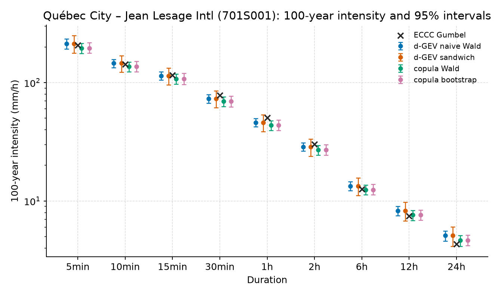
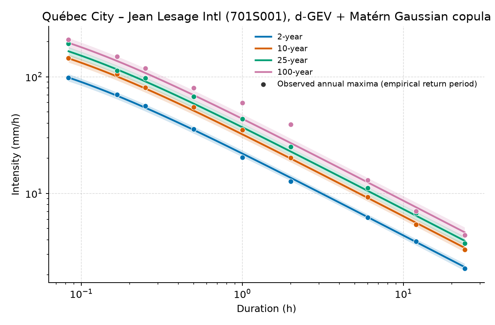
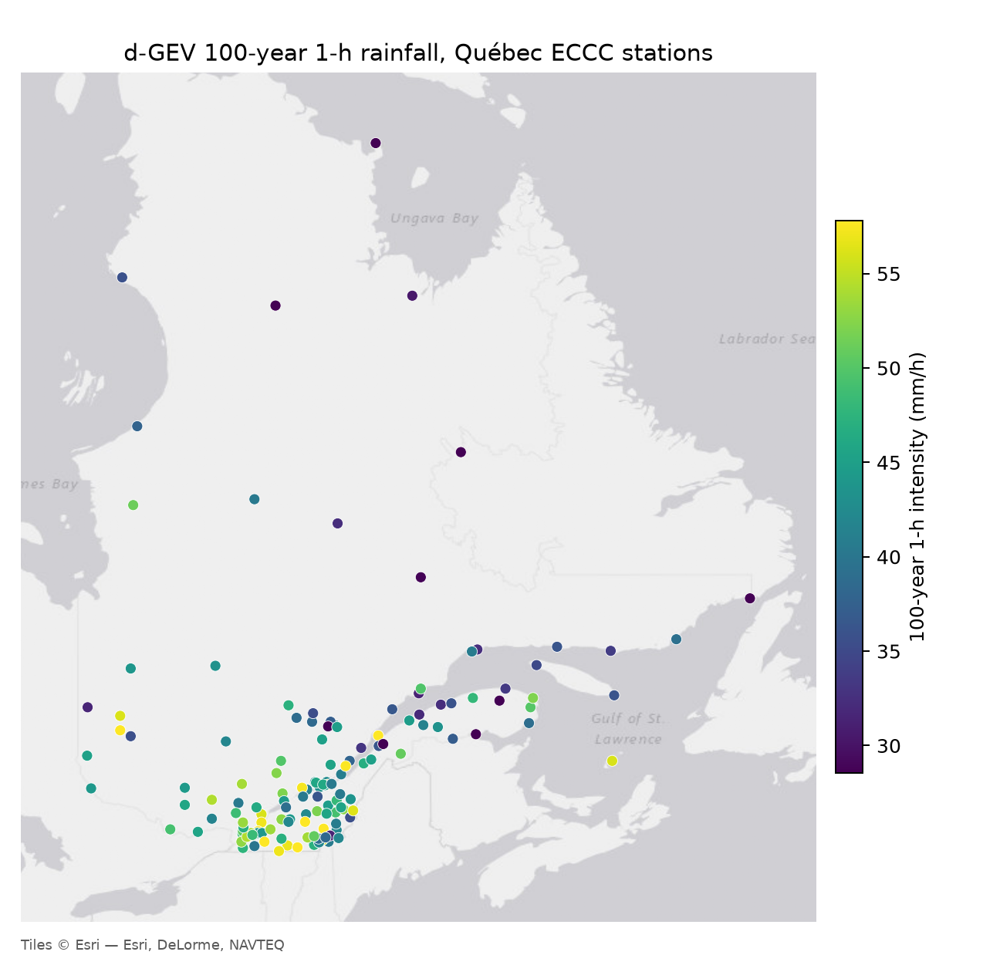

# Tutorial: IDF curves for Québec City, end to end

[](https://colab.research.google.com/github/rare-labs/tails/blob/main/docs/notebooks/tutorial_quebec_idf.ipynb)

A worked answer to *how do I build an IDF curve for a real Canadian station?* using the bundled ECCC record at Québec City (Jean Lesage, `701S001`).

*Generated by `docs/scripts/tutorial_quebec_idf.py` from real ECCC data; every number below is computed, none typed in.* The Open in Colab badge runs this tutorial from `docs/notebooks/tutorial_quebec_idf.ipynb`.

We estimate rainfall intensity–duration–frequency (IDF) curves for **Québec City – Jean Lesage International Airport (ECCC station 701S001, 1961–2024)**, compare models and their uncertainty, check for a trend, and then fit **all 151 Québec stations at once**.

## 1. Data

ECCC's Engineering Climate Datasets (IDF v3.40, 2025-12-05) give, for each station, the annual maximum rainfall *depth* for 9 durations. `tails` bundles the Québec files and converts depths to intensities (mm/h):

```python
from tails.idf import IDFData
data = IDFData.from_eccc("701S001")
```

64 years (1961–2024), 0 missing values. First rows (mm/h):

|   year |   5min |   10min |   15min |   30min |   1h |   2h |   6h |   12h |   24h |
|-------:|-------:|--------:|--------:|--------:|-----:|-----:|-----:|------:|------:|
|   1961 |   73.2 |    62.4 |    43.6 |    24.4 | 19   |  9.5 |  5.8 |   4.4 |   2.6 |
|   1962 |   91.2 |    70.2 |    52.8 |    39.6 | 25.4 | 14.8 | 10.4 |   5.3 |   3   |
|   1963 |  124.8 |   100.8 |    76   |    41.6 | 24.4 | 13.9 |  6.3 |   4   |   2.2 |
|   1964 |   69.6 |    39.6 |    37.6 |    27   | 19   | 12.7 |  4.7 |   2.5 |   2.2 |
|   1965 |  106.8 |    62.4 |    62.8 |    35.6 | 20.3 | 11.1 |  6   |   3.4 |   1.8 |

## 2. One GEV per duration — nine fits in one call

```python
import tails
fit9 = tails.fit_gev(data.values.T)          # shape (9, 64): 9 series
rl = fit9.return_level([100], ci="profile")
```

| duration   |   shape ξ |   100-yr (mm/h) | profile 95% CI   | Wald 95% CI    |   ECCC Gumbel |
|:-----------|----------:|----------------:|:-----------------|:---------------|--------------:|
| 5min       |     -0.03 |          202.78 | [176.8, 273.3]   | [162.1, 243.4] |        207.6  |
| 10min      |     -0.06 |          137.59 | [121.4, 186.0]   | [111.3, 163.8] |        142.8  |
| 15min      |     -0.05 |          111.7  | [97.8, 153.0]    | [89.1, 134.3]  |        115.6  |
| 30min      |      0.1  |           84.7  | [67.7, 152.0]    | [54.0, 115.4]  |         78    |
| 1h         |      0.17 |           56.75 | [44.2, 99.5]     | [35.2, 78.3]   |         50.5  |
| 2h         |      0.17 |           32.22 | [25.7, 50.5]     | [21.8, 42.6]   |         30.05 |
| 6h         |      0.02 |           12.6  | [10.9, 17.3]     | [9.9, 15.3]    |         12.57 |
| 12h        |     -0.08 |            7.1  | [6.4, 8.9]       | [6.0, 8.2]     |          7.44 |
| 24h        |     -0.03 |            4.25 | [3.8, 5.5]       | [3.5, 5.0]     |          4.34 |

Profile-likelihood intervals are asymmetric (longer upper tails), as they should be for 100-year levels; Wald intervals are symmetric by construction. ECCC's published values use a Gumbel (ξ = 0) fit by moments.

## 3. Which scaling model? (Scaling-model test)

```python
from tails.idf import scaling_test
scaling_test(data, "simple"), scaling_test(data, "general")
```

p-values: simple scaling **0.00787**, general scaling (d-GEV) **0.778** (the Zolotarev approximation is only meaningful for small p-values). Simple scaling is rejected; we use the d-GEV.

## 4. d-GEV with and without cross-duration dependence

```python
from tails.idf import fit_idf
ind = fit_idf(data, "general")                       # independence (composite likelihood)
gau = fit_idf(data, "general", "matern")             # Gaussian copula, Matérn on log-durations
stu = fit_idf(data, "general", "exponential", "t", df=5)
```

| model                           |    μ₀ |    σ₀ |         ξ |      α |       δ |   log-lik |     AIC |
|:--------------------------------|------:|------:|----------:|-------:|--------:|----------:|--------:|
| d-GEV, independent durations    | 19.28 | 5.436 |  0.02948  | 0.699  | 0.03163 |  -1792.67 | 3595.34 |
| d-GEV + Matérn Gaussian copula  | 19.89 | 5.706 | -0.04467  | 0.7143 | 0.04461 |  -1415.17 | 2844.33 |
| d-GEV + exponential t(5) copula | 19.83 | 6.493 | -0.001776 | 0.7183 | 0.04451 |  -1452.41 | 2916.82 |

The copula log-likelihoods are far higher: maxima of different durations in the same year are strongly dependent (the same storm), which the independence model ignores. (AIC of the independence model is not comparable — it is a composite likelihood.)

## 5. How uncertain is the 100-year intensity? Three answers, one arbiter

The d-GEV fitted with independent durations needs a **sandwich (Godambe)** covariance; the naive Hessian pretends we have 9 × 64 independent observations. The copula model's Hessian is a proper likelihood Hessian. Because these Wald intervals can disagree by ~2×, `tails` adds a **parametric bootstrap from the joint (copula) model** — simulate 64 years of dependent 9-duration maxima, refit, repeat 500 times, all refits in one batched call:

```python
ind.quantile_ci(d, [100], method="hessian")    # naive
ind.quantile_ci(d, [100], method="sandwich")   # Godambe
gau.quantile_ci(d, [100])                       # copula Hessian
gau.quantile_ci(d, [100], method="bootstrap", n_boot=500)
```

| duration   |   ECCC Gumbel |   d-GEV estimate |   copula estimate | d-GEV naive Wald   | d-GEV sandwich   | copula Wald    | copula bootstrap   |
|:-----------|--------------:|-----------------:|------------------:|:-------------------|:-----------------|:---------------|:-------------------|
| 5min       |        207.6  |           213.52 |            195.43 | [192.5, 234.6]     | [177.7, 249.4]   | [176.0, 214.8] | [174.8, 215.0]     |
| 10min      |        142.8  |           145.86 |            136.58 | [134.2, 157.6]     | [122.4, 169.3]   | [123.5, 149.6] | [122.6, 148.9]     |
| 15min      |        115.6  |           114.14 |            107.71 | [105.1, 123.2]     | [95.8, 132.5]    | [97.3, 118.1]  | [96.5, 117.9]      |
| 30min      |         78    |            73.21 |             69.45 | [67.3, 79.1]       | [61.3, 85.1]     | [62.7, 76.2]   | [62.3, 76.2]       |
| 1h         |         50.5  |            46.06 |             43.61 | [42.3, 49.8]       | [38.6, 53.6]     | [39.5, 47.8]   | [39.2, 47.7]       |
| 2h         |         30.05 |            28.68 |             27    | [26.4, 31.0]       | [24.0, 33.4]     | [24.5, 29.5]   | [24.4, 29.4]       |
| 6h         |         12.57 |            13.4  |             12.45 | [12.3, 14.5]       | [11.1, 15.7]     | [11.3, 13.6]   | [11.3, 13.5]       |
| 12h        |          7.44 |             8.27 |              7.61 | [7.5, 9.0]         | [6.8, 9.7]       | [6.9, 8.3]     | [6.9, 8.3]         |
| 24h        |          4.34 |             5.1  |              4.64 | [4.6, 5.6]         | [4.1, 6.1]       | [4.2, 5.1]     | [4.2, 5.1]         |

The 500 bootstrap refits took 36.8 s. Interval widths at 1 h: d-GEV naive Wald 7.5, d-GEV sandwich 15.0, copula Wald 8.3, copula bootstrap 8.4 mm/h.

Note that the pooled models give a lower 1-h 100-year intensity than both the single-duration GEV and ECCC's Gumbel value: the scaling relation borrows strength from other durations, and at Québec City the 1979 1-h storm sits above the pooled curve. Pooling reduces variance but can bias individual durations — exactly the trade-off a coverage study should quantify.





## 6. Is there a trend? A non-stationary GEV for every duration at once

```python
years = data.years - 2000.0
st = tails.fit_gev(data.values.T)
ns = tails.fit_gev(data.values.T, loc=years)     # mu(t) = b0 + b1 (t − 2000)
lr = 2 * (ns.loglik - st.loglik)                  # likelihood-ratio statistic, 1 df
```

| duration   |   trend in μ (mm/h per decade) |   s.e. |   LR p-value |
|:-----------|-------------------------------:|-------:|-------------:|
| 5min       |                          4.619 |  1.948 |        0.019 |
| 10min      |                          2.141 |  1.347 |        0.109 |
| 15min      |                          1.22  |  1.111 |        0.265 |
| 30min      |                          0.445 |  0.582 |        0.447 |
| 1h         |                          0.076 |  0.348 |        0.827 |
| 2h         |                          0.118 |  0.199 |        0.554 |
| 6h         |                          0.071 |  0.104 |        0.5   |
| 12h        |                          0.034 |  0.066 |        0.608 |
| 24h        |                         -0.021 |  0.035 |        0.564 |

A positive slope with a small p-value suggests the location of annual maxima is drifting up; with nine tests, apply a multiplicity correction before claiming one.

## 7. Scale up: d-GEV for all 151 Québec stations in one call

```python
stations = [IDFData.from_dataframe(g, year="year", depth=True, name=sid)
            for sid, g in load_eccc_quebec().groupby("station_id")]
all_fit = fit_idf(stations, "general")   # one batched optimisation, missing values masked
```

147 stations with ≥ 8 years for every duration were fitted in **0.38 s** (after compilation); 100% converged. The 100-year 1-h intensity ranges from 15 to 75 mm/h (median 44).



## Caveats

- ECCC annual maxima mix station histories (composite records); check metadata before inference.
- The d-GEV assumes a common shape ξ across durations; the scaling test above is the check.
- Wald intervals for 100-year levels can under-cover; prefer profile or bootstrap intervals.
